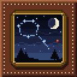

<p align="center"></p>

<h1 align="center">Star_Struck</h1>

<p align="center">
Stargaze through a spyglass or telescope to find constellations, planets and comets, fill your Star Atlas,
and unlock charms and weather-bending blocks under a sky that's different every night.
</p>

<p align="center">
<a href="https://www.curseforge.com/minecraft/mc-mods/star-struck"><b>Download on CurseForge</b></a>
</p>

---

Hold a spyglass up at night and the world goes dark, then opens on a hand-painted night sky. Find the
constellations in it, track the planets that wander across it, and study the night sky.

The sky is different every night of the year, and it holds still all night. What you find also pays off on the
ground, with blocks that stop the rain, a jar with a storm in it, and a lodestone that brings you home by the
North Star.

## Features

- **The star view**: a brand new way to look at the night sky, through a spyglass or a telescope you can upgrade.
- **24 constellations**, each with its own figure. The 16 bright ones you find by holding your view on them, the
  8 hidden ones you trace star by star with a Star Lens.
- **6 planets**, plus nebulae, galaxies, star clusters and the Wanderer's Comet.
- **The Star Atlas**, a saddlebag journal that fills up with everything you find.
- **Forgotten Recipes**: torn-out pages that come back as you find things and let you craft straight from the book.
- **Orrery tasks**: a new task every night, worth Star Shards.
- **Blocks**: the Cloudbuster, Storm Jar, Orrery, Sky Window, North Star Lodestone, Star Lamp and Nebula Glass.
- **Six planet charms** with abilities of their own.

## How it works

On a clear night, hold a spyglass and look up, or build a Telescope. Get a whole constellation in the lens with its
middle under the sight and hold still: the studs round the rim light up one by one, the stars join, and its figure
glows. New finds go in your Atlas and give you rewards.

Rain and clouds hide the sky, and some constellations only show in dry lands where it never rains. A bright moon
hides faint stars. Planets wander, so you need to spot one on three different nights to track it.

## Requirements

- Minecraft **1.21.1**, **NeoForge**
- [GeckoLib](https://www.curseforge.com/minecraft/mc-mods/geckolib)
- [Curios](https://www.curseforge.com/minecraft/mc-mods/curios)
- Install on the server and on every player's game.

**Works with**: [Starcatcher](https://www.curseforge.com/minecraft/mc-mods/starcatcher) (catch rain-only fish
when fishing near a Storm Jar) and shaders. Tested with over 500 mods. If you find an incompatibility, please
leave a comment on the CurseForge page.

## Building from source

Needs JDK 21.

```
./gradlew build
```

The jar ends up in `build/libs/`. The Starcatcher compatibility compiles against Starcatcher and wdUtils jars in
`libs/`, which aren't in this repo: download them yourself and put them there.

`tools/` holds the Python scripts that paint the textures and write the data files (`make_art.py`,
`generate_data.py`), and `models/` holds the Blockbench sources for the block models.

## Bugs and ideas

Leave a comment on the [CurseForge page](https://www.curseforge.com/minecraft/mc-mods/star-struck). Screenshots
help a lot, especially of anything that looks wrong in the sky or the Atlas.

## License

All Rights Reserved. © The_Letter_A. The code is here to read; please don't re-upload the mod or its art.
